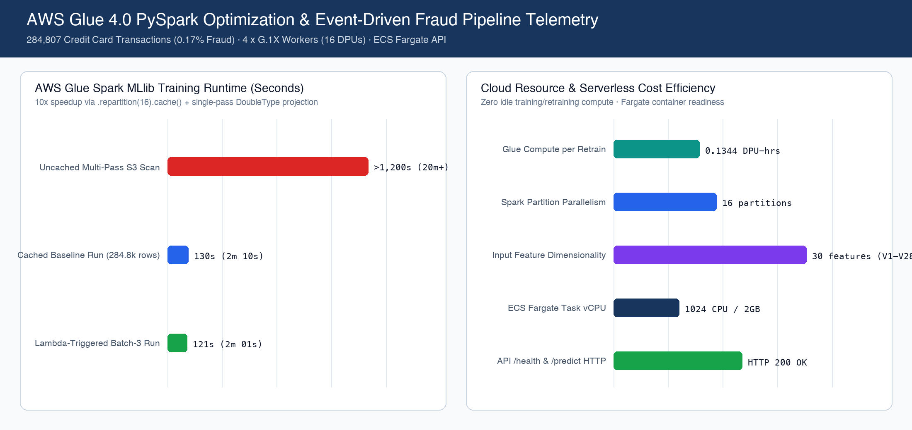
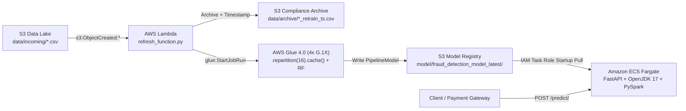
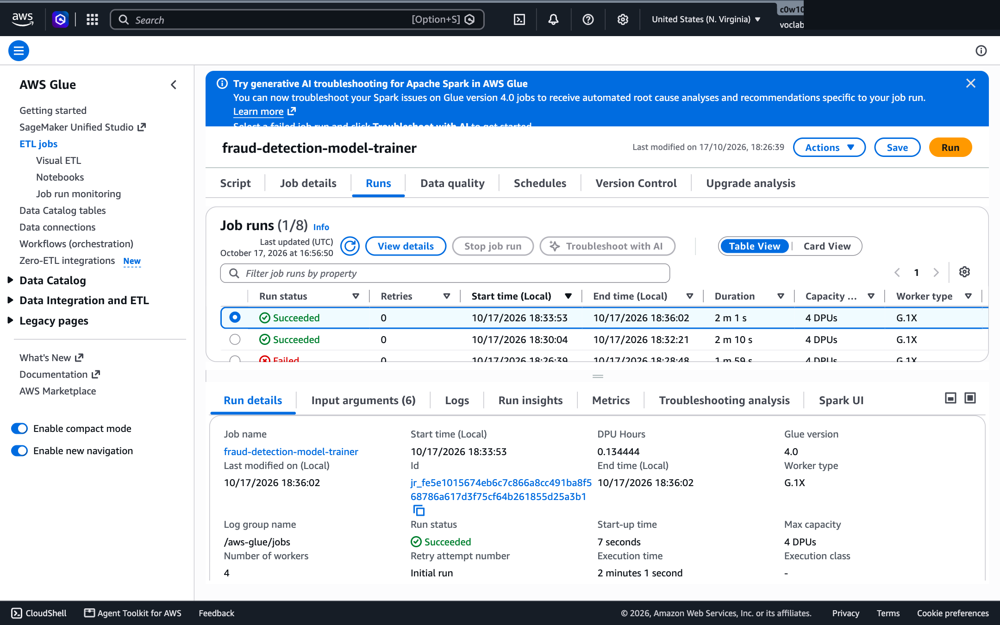
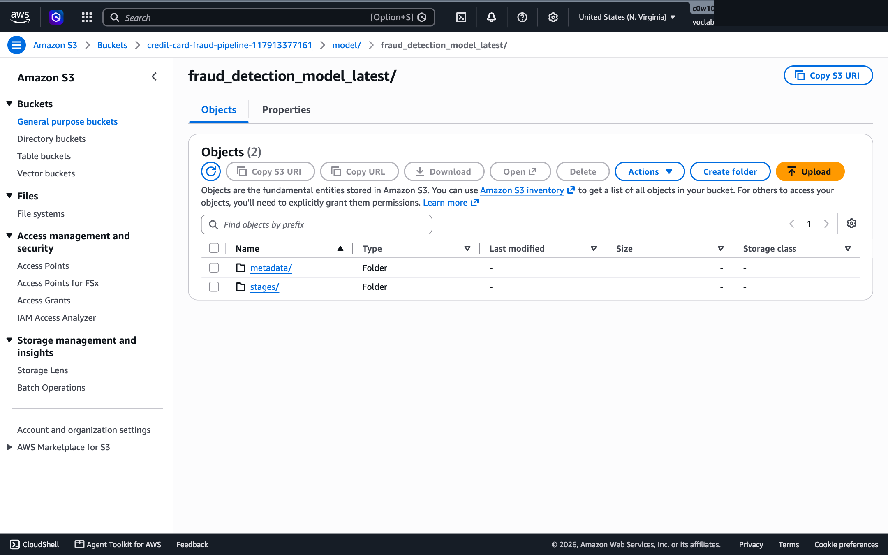
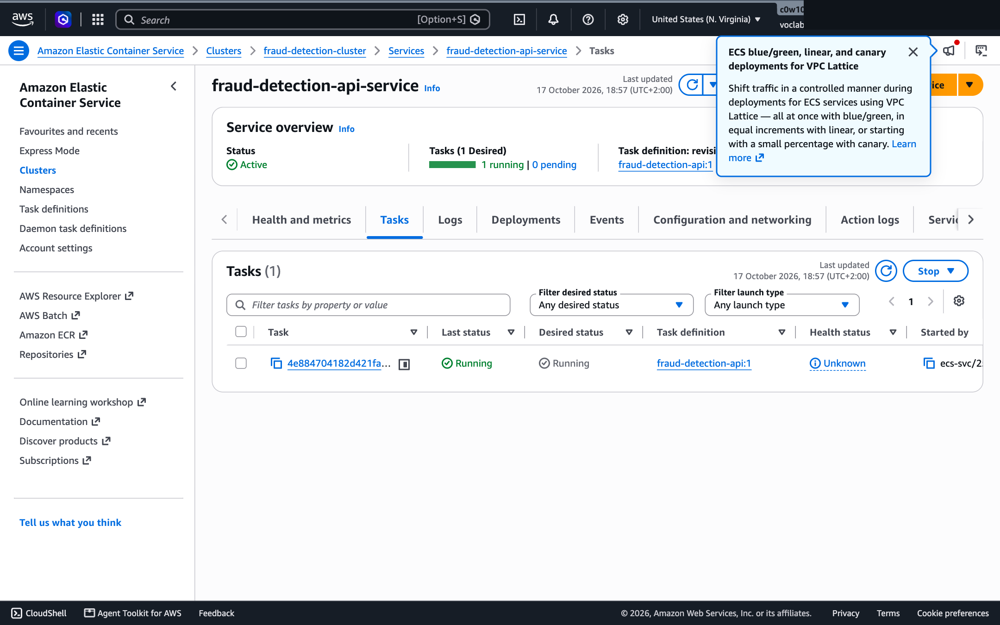
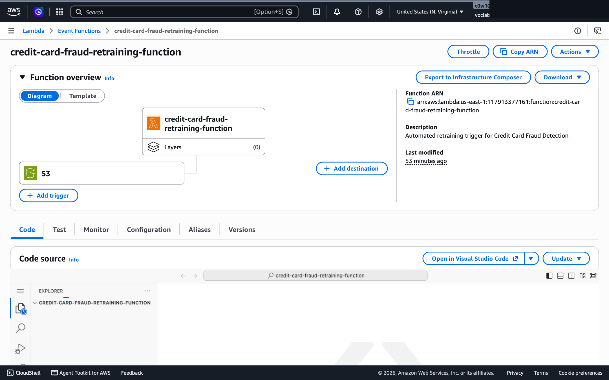
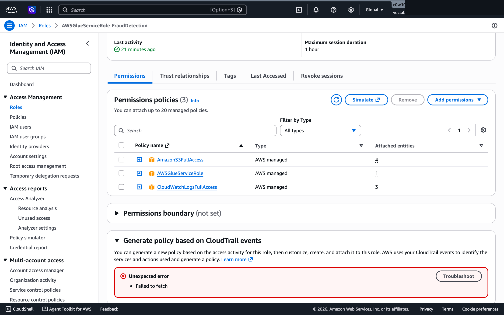
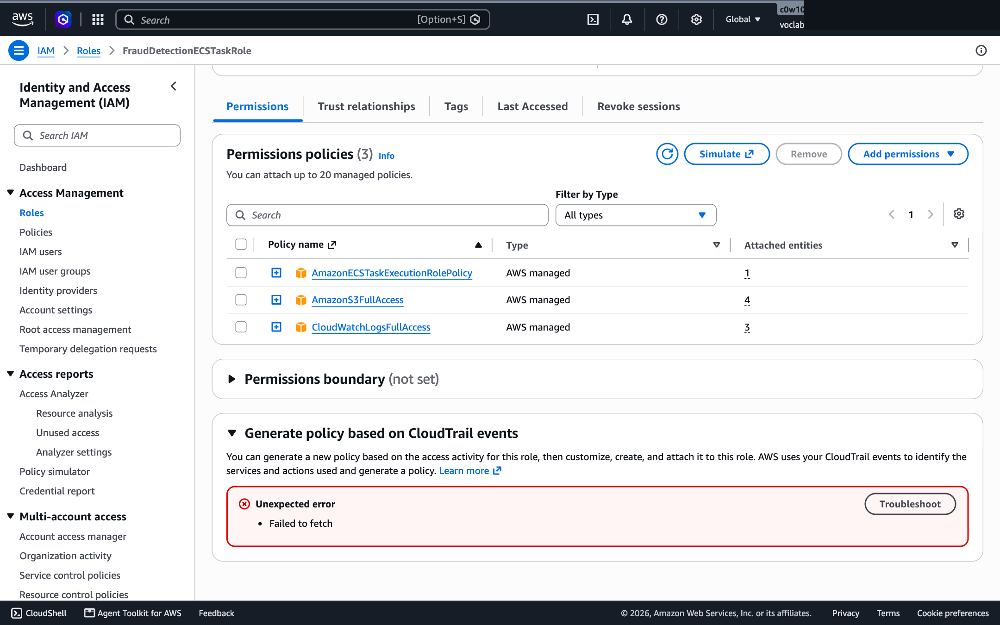

<div align="center">
  
  <br/><br/>
  <p>
    
    
    
    <a href="LICENSE"></a>
  </p>
</div>

---

Production AWS machine learning platform migrating local PySpark credit card fraud detection (`284,807` transactions, severe `0.17%` fraud imbalance) to **serverless AWS Glue 4.0 distributed MLlib training**, **S3 event-driven AWS Lambda automated retraining & compliance archival**, and an **Amazon ECS Fargate FastAPI + PySpark real-time inference microservice**.



---

## 1. Event-Driven Serverless & Containerized Architecture



---

## 2. Verified AWS Production Execution Gallery

| AWS Glue 4.0 Distributed Training (`2m 01s`, `0.1344 DPU-h`) | Serialized Spark MLlib `PipelineModel` in S3 |
| :---: | :---: |
|  |  |

| Amazon ECS Fargate Service & Live `curl /predict/` | S3 Event-Triggered Lambda Retraining & Archival |
| :---: | :---: |
|  |  |

| IAM Roles: AWS Glue & AWS Lambda | IAM Task & Execution Role: Amazon ECS Fargate |
| :---: | :---: |
|  |  |

Full architectural trade-offs and IAM policy matrices are documented in [`docs/ARCHITECTURE_REPORT.md`](docs/ARCHITECTURE_REPORT.md).

---

## 3. Live ECS Fargate Inference Verification

```json
// GET /health -> HTTP 200 OK
{
  "status": "healthy",
  "model_loaded": true,
  "spark_version": "3.3.0"
}

// POST /predict/ -> HTTP 200 OK
{
  "prediction": 0.0,
  "is_fraud": false
}
```

---

## 4. Repository Structure & Local Docker Quick Start

```text
aws-serverless-fraud-ml-pipeline/
├── fraud_detection_pipeline/            # AWS Glue 4.0 PySpark MLlib trainer (VectorAssembler + StandardScaler + RF)
├── refresh_function/                    # AWS Lambda S3 event archival & Glue job trigger
├── fraud_detection_api/                 # FastAPI + PySpark + OpenJDK 17 inference container & serialized model
├── ecs/fraud-detection-task-def.json    # AWS Fargate (1024 CPU / 2048 MB) task definition
├── data/incoming_transactions_batch3.csv# Sample 30-feature streaming batch (Time, V1..V28, Amount)
├── docs/ARCHITECTURE_REPORT.md          # Complete AWS service rationale & IAM role matrix
└── evidence/                            # Verified AWS Console, CloudWatch & live API screenshots
```

```bash
docker build -t fraud-detection-api ./fraud_detection_api
docker run -p 8000:8000 fraud-detection-api
curl http://localhost:8000/health
```

## License

MIT License — see [LICENSE](LICENSE).
